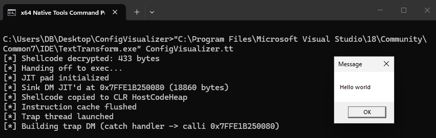

# TTs - Text Transform Shells

[](https://www.buymeacoffee.com/whokilleddb)


Payload builder that generates shellcode loaders executed via `TextTransform.exe` and `.tt` files.



## How It Works

1. Embeds XOR-encrypted shellcode into a generated C# assembly
2. Compiles the assembly with the .NET Framework CSC
3. Generates a `.tt` file that base64-loads the assembly and invokes it
4. Packages the `.tt` file alongside `TextTransform.exe` and its dependencies

Shellcode execution uses the [3lkToShell](https://github.com/whokilleddb/3lkToShell) technique — a DynamicMethod JIT spray creates an RWX region in the CLR's HostCodeHeap, shellcode is copied there, and a second DynamicMethod executes it from inside a catch handler (SEH 2nd pass). No `VirtualAlloc` appears in the stack trace.

## Usage

```
python main.py --shellcode <path> --output-dir <dir> [--assembly <name>] [--delay <minutes>] [--debug]
```

| Flag | Required | Description |
|------|----------|-------------|
| `--shellcode` | Yes | Path to raw shellcode binary |
| `--output-dir` | Yes | Directory to write the packaged payload |
| `--assembly` | No | Assembly/namespace name (random if omitted) |
| `--delay` | No | Minutes to delay execution, 0-15 (default: 8) |
| `--debug` | No | Compile assembly with debug output |

### Example

```
python main.py --shellcode bins\shellcode\test.bin --output-dir build
```

### Running the Payload

```
TextTransform.exe <AssemblyName>.tt
```

or 

```
"C:\Program Files\Microsoft Visual Studio\18\Community\Common7\IDE\TextTransform.exe" <AssemblyName>.tt
```